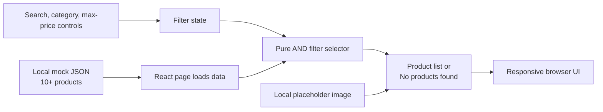

# Architecture — SCRUM-5: Implement Product Search and Filter

## Status and source of truth

- **Architecture gate:** `READY_FOR_ARCHITECTURE` requirements accepted; architecture prepared for independent design review.
- **Canonical requirements:** [`docs/requirements.md`](requirements.md), status `READY_FOR_ARCHITECTURE`.
- **Jira source:** [SCRUM-5 — Implement Product Search and Filter](https://epam-team-d41wx5ya.atlassian.net/browse/SCRUM-5).
- **Scope:** The approved requirements and their recorded decisions Q-01–Q-05 are authoritative. This document does not add product behavior or claim implementation/test evidence.
- **Repository evidence:** The repository is a Copilot/Agentic SDLC framework containing configuration, guidance, and workflow documents. At inspection it had no application source, package manifest, React app shell, product assets, or Vitest/Playwright configuration. The README describes it as framework configuration, not an application implementation.

## 1. Architecture overview and goals

Design a small client-only React product listing. Local mock JSON is the sole product-data source; filter state stays in the page, and a deterministic in-memory selector derives visible products whenever a control changes. There is no API, backend, database, account system, or external product integration.

Goals:

1. Meet FR-001–FR-010 and AC-001–AC-008 with the approved filter semantics.
2. Keep the implementation and test surface small and separable: product data, pure filtering/formatting logic, accessible UI, and focused Vitest/Playwright coverage.
3. Keep all product data and placeholder imagery local and avoid transmitting user-entered search text.
4. Preserve framework-repository boundaries: this architecture describes a feature/app to be implemented under the requirements, not a change to the framework itself. No package manager, bundler, server, or deployment platform is evidenced or selected here.

### High-level flow



## 2. Components and responsibilities

These are logical components, not existing repository files. A compact implementation may colocate the page and small components where the chosen project setup makes that simpler.

| Component | Responsibility | Requirement links |
|---|---|---|
| Product data module | Import local JSON with at least 10 records; expose product name, category, numeric USD price, and local image reference. Provide a stable technical key for list rendering. | FR-002, FR-010; AC-001 |
| Product listing page / filter controls | Own the search query, category selection, and optional maximum price. Render labeled search, category dropdown, numeric maximum control, and Clear Filters action. Recompute results on each change. | FR-001, FR-003–FR-006, FR-008; AC-002–AC-005, AC-007 |
| Filter selector | Pure function over product collection and filter state. Apply non-empty case-insensitive substring name matching, selected-category matching, and inclusive price ceiling; combine active predicates with AND. An empty query, All categories, and absent ceiling are unrestricted. | FR-001, FR-003–FR-006; AC-002–AC-005 |
| Product result view | Render each matching product's name, image, category, and USD price to two decimal places. Use the same local placeholder for mock products and as the image error fallback. Render the exact empty-results text when the result set is empty. | FR-002, FR-007; AC-001, AC-006 |
| Responsive presentation | Use semantic HTML and CSS layout that reflows at the approved mobile and desktop sizes without horizontal overflow; maintain usable controls. | FR-009; AC-008 |
| Unit tests (Vitest) | Verify filtering/formatting and positive, negative, and boundary cases independently of browser rendering. | NFR-002, NFR-005, NFR-006; AC-002–AC-004, AC-006–AC-007 |
| UI automation (Playwright) | Exercise the visible listing and controls, reset behavior, image fallback, empty state, and specified viewport behavior. | NFR-003, NFR-005, NFR-006; AC-001–AC-008 |

### Suggested minimal product shape

The approved source requires displayed name, image, category, and price; a stable `id` is a technical rendering key. A minimal record can therefore be represented as:

```text
{ id, name, category, price, image }
```

Use numeric prices in USD and local image paths. Category values are the three approved categories: Electronics, Clothing, and Home. Exact product names, sample values, and image file format are not set by the source and remain implementation choices; the mock set must contain at least 10 records. This shape is a recommendation to support the approved UI, not an additional business requirement.

## 3. Technology choices and rationale

| Decision | Basis and rationale |
|---|---|
| React UI using HTML and CSS | Required by TR-01 / NFR-001. The framework repository has no application framework conventions to extend. |
| Local JSON data; no API/backend/database | Local mock JSON with at least 10 products is required by TR-02 / FR-010; no backend or database is required by TR-05 / NFR-004. Import data locally rather than introducing a remote dependency. |
| Vitest for unit tests | Required by TR-03 / NFR-002. Use it for deterministic selector and formatting behavior. |
| Playwright for UI automation | Required by TR-04 / NFR-003. Use it for browser-observable acceptance criteria and viewport checks. |
| No further toolchain choice in this architecture | Repository inspection found no package manifest, app, or test configuration that supports selecting a package manager, bundler/dev server, or versions. Do not imply one is already available. The implementation planner should assess the target execution setup and choose the smallest compatible means of running the React app and required tests without changing the approved stack or adding a backend. |

## 4. Interfaces and data flow

### Data and UI state

1. The page imports the local JSON collection at startup; no network request is made.
2. Filter state is local to the page:
   - `query`: text, initially empty.
   - `category`: one of All categories, Electronics, Clothing, or Home; initially All categories.
   - `maxPrice`: numeric ceiling or absent (`null`); initially absent.
3. On every control change, derive the visible collection synchronously from the loaded collection and current state. Do not add an Apply action, debounce requirement, or separate latency guarantee (Q-04).
4. A product is retained only if it passes every active predicate:
   - `query` is empty, or the product name contains the query without case sensitivity.
   - `category` is All categories, or equals the product category.
   - `maxPrice` is absent, or `product.price <= maxPrice`.
5. Render the filtered collection. If it is empty, render exactly `No products found`.
6. Clear Filters resets all three values to their initial unrestricted states.

### Price control semantics

Use a numeric maximum-price control with its permitted numeric bounds derived from the mock data (minimum and maximum product prices). Represent “no maximum” as a distinct unset state, not as the highest numeric bound: the initial/reset state must impose no maximum restriction, including for any future data variation. When a numeric value is set, equality is included. Display product prices in USD to two decimal places. The requirements do not prescribe the visual control subtype, increment, or behavior for malformed values; implementation should use a native numeric control and prevent invalid values from becoming filter state without inventing additional price policy.

### External integrations

None at runtime. There is no remote data, image host, analytics, authentication, or persistence integration in scope. React, Vitest, and Playwright are the source-mandated technologies, not external runtime services.

## 5. Error handling and failure behavior

- **No matching records:** Display exact text `No products found` (FR-007 / AC-006).
- **Missing/unavailable product image:** Show the same local placeholder used for mock product images (FR-002 / AC-001, Q-03). The fallback should avoid repeatedly attempting a failed source.
- **Malformed local data:** This is not a user-facing business flow specified by the source. Keep data local and typed/validated by the implementation as practical; tests should catch missing display fields and invalid prices. Do not silently add product records or network recovery behavior.
- **Control input:** Native numeric constraints should keep the selected price within data-derived bounds. An unset value remains unrestricted; invalid text must not be interpreted as a valid ceiling.
- **Runtime/service errors:** No API or backend is present, so there are no network retries, server error states, or persistence recovery flows to design.

## 6. Security, privacy, and data handling

- Product data and images are local static mock content. No customer data or search terms need to leave the browser; no backend or database is introduced (NFR-004).
- Render the query and product fields as ordinary text through React's text rendering, not as HTML. Do not construct HTML from search input.
- Keep image references local to the app and use a controlled local placeholder fallback. Do not add remote image URLs or third-party scripts for this feature.
- No authentication, authorization, secrets, cookies, or personal data handling is required by the approved requirements. Do not add any.
- Security checks and code review remain later completion gates under NFR-007; this architecture is not evidence that they have passed.

## 7. Responsive design and accessibility

- Use semantic headings, a labeled search input, a labeled category `<select>`, a labeled numeric price control, and a clearly named Clear Filters button. Controls must remain keyboard-operable with visible focus.
- Use a responsive CSS layout that reflows filter controls and product cards at 375×667 and 1366×768 without horizontal overflow. Avoid fixed widths that force page-level scrolling; allow product content to wrap within the viewport.
- Keep product name/category/price available as text, independent of the image. Provide meaningful image alternative text from the product name; placeholder imagery must not be the only way product identity is communicated.
- Verify control usability and overflow at both approved viewport sizes. These implementation recommendations support AC-008 and do not add a different viewport or user-facing feature requirement.

## 8. Logging, observability, and configuration

- This client-only mock feature has no operational service or backend to instrument. No telemetry or analytics is required; do not capture search text.
- No runtime secrets or environment-specific API configuration are needed.
- Test failures should identify the relevant behavior/acceptance case through descriptive test names. Browser-console diagnostics may be used during development, but production logging behavior is not a requirement.
- Local serve/build commands and configuration remain to be selected after the implementation phase identifies the compatible execution setup; do not encode environment assumptions in this architecture.

## 9. Test architecture and dependency strategy

### Vitest unit tests

Keep the filter selector pure and test it against the local fixture. Include:

- Case-insensitive substring match, non-match, and empty-query behavior.
- Each category option and All categories unrestricted behavior.
- Inclusive maximum-price equality; products above the ceiling excluded; absent maximum unrestricted.
- Combined search/category/price predicates using AND, including a zero-result case.
- Clear/reset state values and USD two-decimal formatting.
- Data fixture contract: at least 10 mock products with fields required by the UI and categories from the approved list.

These tests support NFR-005 and AC-002–AC-007. Exact fixture product names/values can be chosen to expose the boundaries without implying additional catalog behavior.

### Playwright UI automation

Drive the actual page through its accessible controls and assert:

- Product cards expose name, image, category, and USD two-decimal price; image fallback works (AC-001).
- Search, category, and price controls update results on change with no Apply action; combined filters honor AND semantics (AC-002–AC-005).
- A nonmatching selection shows exact `No products found` (AC-006).
- Clear Filters restores empty search, All categories, no maximum, and unrestricted results (AC-007).
- At 375×667 and 1366×768, page content has no horizontal overflow and each control is visible/usable (AC-008).

Use deterministic local data and no remote test dependencies. Unit tests validate calculation rules; Playwright validates rendered/user-observable behavior. NFR-006 requires both suites to pass before completion; no test execution is claimed here.

### Dependency strategy

Keep runtime dependencies minimal: React plus the approved local data/assets. Add only the tooling needed for the source-mandated Vitest and Playwright checks and a compatible way to run the app. No state-management package, server framework, database driver, network client, or external image dependency is justified by this scope. Versions and package manager are not specified by the requirements or existing repository.

## 10. Runtime and deployment considerations

The runtime is a browser-rendered React UI using bundled/local JSON and local placeholder assets. The feature has no server-side runtime, API, database, or network dependency. It can be served as static frontend output or by a local development server; the repository contains no established app/deployment pipeline to select between these. Do not treat either option as an existing repository convention. The implementation planner must confirm how the app will be run in this framework repository (or its intended target) and configure Playwright to use that same local app runtime.

## 11. Requirement-to-component and decision traceability

Canonical requirement IDs and source mappings remain those in `docs/requirements.md` §8. The Jira acceptance-criterion references below are the original `AC1`–`AC8`; their normalized stable requirement-document IDs are `AC-001`–`AC-008`. Q decisions are the user-approved clarifications recorded on 2026-11-13 in requirements §3 and §9.

| Requirement / source | Architecture component or decision | Acceptance coverage / design evidence |
|---|---|---|
| FR-001; S-01; Jira AC2–AC4; Q-01 | Product listing page; pure AND filter selector; Decision D-02 | AC-002–AC-004; all active filters combine with AND |
| FR-002; Jira AC1; Q-02/Q-03 | Product result view; local product data and placeholder; Decision D-01/D-03 | AC-001; all required fields, USD 2-decimal display and placeholder fallback |
| FR-003; Jira AC2; Q-01 | Search control and selector; Decision D-02 | AC-002; case-insensitive substring; empty is unrestricted |
| FR-004; Jira AC3; Q-01 | Category dropdown and selector; Decision D-02 | AC-003; three categories plus unrestricted All categories |
| FR-005; Jira AC4; Q-02 | Numeric maximum control and selector; Decision D-02 | AC-004; data-derived bounds, optional/unset state, inclusive ceiling, USD format |
| FR-006; Jira AC5; Q-04 | Page-owned state derives results on each change; Decision D-02 | AC-005; no Apply action; no additional latency threshold |
| FR-007; Jira AC6 | Product result view empty state | AC-006; exact `No products found` |
| FR-008; Jira AC7; Q-01/Q-02 | Page Clear Filters action restores initial state | AC-007; query empty, All categories, no maximum |
| FR-009; Jira AC8; Q-05 | Responsive CSS and Playwright viewport checks | AC-008; 375×667 and 1366×768, reflow, no horizontal overflow, usable controls |
| FR-010; TR-02 | Local JSON data module; Decision D-01 | At least 10 products; supports AC-001 |
| NFR-001; TR-01 | React UI, HTML semantics, CSS; Decision D-01 | Repository inspection/implementation review |
| NFR-002; TR-03 | Vitest unit suite; test architecture | Unit behavior and boundary coverage; result pending verification |
| NFR-003; TR-04 | Playwright browser suite; test architecture | UI and viewport coverage; result pending verification |
| NFR-004; TR-05 | Local-only data flow; no server or persistence; Decision D-01 | Dependency/runtime inspection |
| NFR-005; DOD-02 | Vitest and Playwright cases listed above | Positive, negative, and boundary scenarios; result pending verification |
| NFR-006; DOD-03 | Verification gate for both suites | Pass evidence pending later verification |
| NFR-007; DOD-04 | Code review/security review gates | Completion evidence pending later workflow gates |
| NFR-008; DOD-05 | SDLC documentation gate | Approval evidence pending later workflow gates |
| NFR-009; DOD-06 | PR publication gate after successful verification | Not an architecture/runtime component; outcome pending later workflow |

### Architecture decisions

- **D-01 — Local-only, minimal client architecture.** Use React/HTML/CSS with local mock JSON and local placeholder assets; no backend/database. Source: TR-01, TR-02, TR-05; FR-010; NFR-001/NFR-004; AC-001.
- **D-02 — Single page-owned filter state and pure AND selector.** Derive results from the data and three filter values on every edit; use empty/All/absent as unrestricted; include price equality. Source: S-01, AC2–AC5; FR-001, FR-003–FR-006; Q-01/Q-02/Q-04.
- **D-03 — Local image fallback and fixed currency presentation.** Use a local placeholder for mock image values and the same fallback on image failure; format price in USD with two decimals. Source: AC1; FR-002; Q-02/Q-03.
- **D-04 — Required test split.** Vitest covers pure logic and edge conditions; Playwright covers rendered behavior, reset, fallback, and responsive criteria. Source: TR-03/TR-04; DOD-02/DOD-03; NFR-002/NFR-003/NFR-005/NFR-006.
- **D-05 — Do not select an un evidenced app toolchain.** The current repository is framework configuration and does not provide an application or test setup. Leave package manager, versions, dev server/bundler, and deployment target to the implementation planner after target execution needs are confirmed; preserve the mandated framework/testing technologies. Source: repository inspection plus NFR-001–NFR-004.

No `IMP-###` tasks, implementation files, tests, or verification results exist in this architecture phase. The implementation planner is responsible for adding the next traceability links without changing requirement IDs.

## 12. Assumptions, risks, and unresolved questions

### Explicitly bounded implementation choices

- Product `id` is a technical key; exact names and sample prices are deliberately unspecified.
- A local placeholder asset and numeric price bounds are derived from the local data, as required by Q-02/Q-03.
- A page-local state model and pure selector are design choices to keep this small client-only feature simple; they introduce no persistence or business behavior.
- The browser-serving/toolchain setup is not inferred from the repository. The implementation planner must resolve it based on the intended execution target; this is a planning dependency, not an unresolved product question or blocker to this architecture.

### Risks and mitigations

| Risk | Mitigation |
|---|---|
| Framework repository has no application/toolchain convention; a full app scaffold may add files/dependencies outside its usual purpose. | Keep this architecture isolated from framework configuration; planner confirms intended target and minimum compatible tooling before implementation. |
| Confusing the maximum data-derived bound with the unrestricted default could incorrectly filter products after load/reset. | Model no maximum separately from numeric ceiling and test initial/reset behavior against the full dataset. |
| Sample data might omit category or price boundary cases. | Select a deterministic 10+ record fixture that enables positive, negative, combined, and equality tests without asserting a real catalog. |
| Local image paths can still fail due to missing files or bad references. | Include the shared local placeholder and cover the fallback in UI automation. |
| Responsive controls/cards can overflow at narrow widths. | Check document width and control usability at both approved Playwright viewport sizes. |

### Unresolved design questions

No new product-level ambiguity blocks architecture. Q-01 through Q-05 are resolved and carried forward exactly from the approved requirements. The target app execution/toolchain location remains a non-blocking implementation-planning decision because this framework repository has no application shell or package/test setup; it must not be guessed from this architecture.
